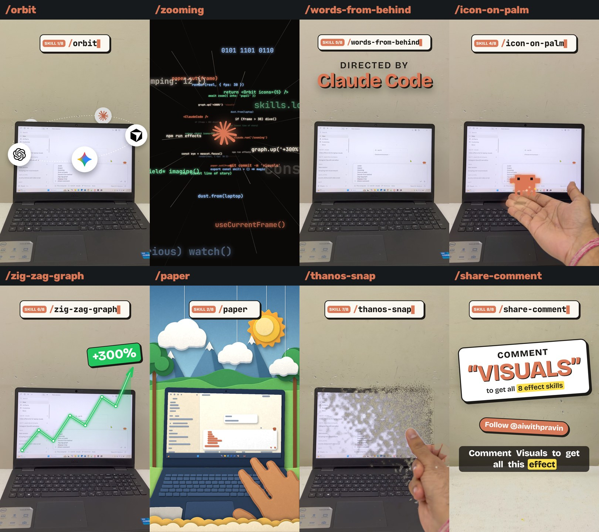

# /visuals: 8 video effect skills for Claude Code

<p align="center">
  
</p>

**Stop paying editors for effects. Type these instead.**

Film your laptop on a desk, type `/orbit` (or any of the 8 commands) in Claude Code, and Claude turns that moment of
your own footage into a finished effect clip. These are the skills from the
[@aiwithpravin](https://www.instagram.com/aiwithpravin/) reel; every effect in the image above was rendered from
real phone footage.

| command | effect |
|---|---|
| `/orbit` | logos fly out of the screen, orbit the lid on a tilted ring (back half behind the lid), get sucked back in |
| `/zooming` | exponential push into one point on screen (a mascot's eye), into a tunnel of flying code, and back out |
| `/words-from-behind` | "Directed by Claude Code" rises from behind the lid, steps forward, sinks back |
| `/icon-on-palm` | a character drops onto your open palm, hops and glows while tracking your hand |
| `/zig-zag-graph` | a glowing up-trend line draws itself with your finger, then a "+300%" tag springs in |
| `/paper` | torn-paper wipe into a layered paper-craft diorama of your laptop and hand, with pop-up scenery |
| `/thanos-snap` | snap: the laptop crumbles into drifting ash and stays gone |
| `/share-comment` | end card: a bouncing sticker, "COMMENT 'VISUALS'", plus a follow pill |

Each skill is a `SKILL.md` (what Claude follows) plus one Python script that does the rendering locally. There is
no cloud service, no API key and no editor needed.

---

## What's in this repo

```
.
├── README.md                ← you are here
├── LICENSE                  ← MIT
├── requirements.txt         ← opencv-python, numpy, pillow
├── install.sh / install.ps1 ← copy the 9 skill folders into ~/.claude/skills
├── docs/
│   ├── hero.jpg
│   └── SHOOTING.md          ← how to film for these effects (read before you record)
├── examples/
│   └── rows.json            ← keyboard layout example for /paper
└── skills/
    ├── visuals-core/        ← shared engine: vfx.py, grid.py, mask.py (required by all 8)
    ├── orbit/               ← SKILL.md + orbit.py
    ├── zooming/             ← SKILL.md + zooming.py
    ├── words-from-behind/   ← SKILL.md + words_from_behind.py
    ├── icon-on-palm/        ← SKILL.md + icon_on_palm.py
    ├── zig-zag-graph/       ← SKILL.md + zig_zag_graph.py
    ├── paper/               ← SKILL.md + paper.py
    ├── thanos-snap/         ← SKILL.md + thanos_snap.py + plate.py
    └── share-comment/       ← SKILL.md + share_comment.py
```

## Prerequisites

1. **[Claude Code](https://docs.anthropic.com/en/docs/claude-code/overview)**
2. **Python 3.9+** with `pip install -r requirements.txt` (OpenCV, NumPy, Pillow)
3. **ffmpeg** on your PATH: [ffmpeg.org/download](https://ffmpeg.org/download.html) (Windows: `winget install Gyan.FFmpeg`, macOS: `brew install ffmpeg`)
4. Optional: Chrome or Edge installed (used headless to draw SVG logos for `/orbit` and `/zooming`; PNG logos need nothing)

## Install

**Option A: let Claude do it.** Paste into Claude Code:

```
https://github.com/solankipravin374/visuals-skills
Install these skills, install the Python requirements, then confirm /orbit works.
```

**Option B: one command.**

```bash
git clone https://github.com/solankipravin374/visuals-skills.git
cd visuals-skills
pip install -r requirements.txt
bash install.sh            # macOS / Linux / Git Bash
```

```powershell
git clone https://github.com/solankipravin374/visuals-skills.git
cd visuals-skills
pip install -r requirements.txt
./install.ps1              # Windows PowerShell
```

This copies all 9 folders to `~/.claude/skills/`. **Keep them side by side:** every effect imports
`../visuals-core/vfx.py`. Restart Claude Code and type `/orbit`.

**Check it works** (no Claude needed):

```bash
python ~/.claude/skills/zig-zag-graph/zig_zag_graph.py --help
```

## Use it

1. **Film** following [docs/SHOOTING.md](docs/SHOOTING.md): tripod, laptop low in the frame, plain wall above, a few
   hand-free seconds, and a clean plate of the empty desk if you want `/thanos-snap`.
2. **Open Claude Code in the folder with your clip** and type the command, e.g.
   `/orbit clip.mp4 at 26s for 2.9s with chatgpt, claude and gemini logos`.
3. Claude measures the frame (`grid.py`, `mask.py`), renders **preview stills**, checks them, then renders the clip.
4. Stitch the clips in your editor (or with `ffmpeg -f concat`, see `skills/visuals-core/SKILL.md`).

Every script also runs on its own. Try `python skills/<effect>/<script>.py --help` for all flags, and
`--preview 0.5,1.5` for instant stills.

## Good to know

- **Built for a locked-off camera.** The lid occlusion, hand tracking and clean plate all compare against still
  frames. A handheld shot will not work.
- **Dark laptop, lighter wall** is what the automatic laptop mask expects. Anything else: pass `--mask` with your own PNG.
- **Brighten dark footage** with `--gamma 0.86` on any effect; fix a colour cast with `--wb`.
- **No logos or mascots are bundled.** Brand logos are their owners' trademarks; use them for commentary, not to
  imply endorsement. `/icon-on-palm` ships its own pixel robot.
- `/paper` is the slow one (2-3 s per frame on a laptop CPU); everything else renders a 3 s clip in under a minute.

## Credits and licence

Made by [Pravin Solanki (@aiwithpravin)](https://www.instagram.com/aiwithpravin/) with Claude Code. MIT licence:
use it, change it and ship it, keeping the copyright notice.
